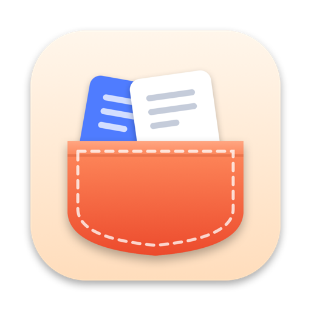
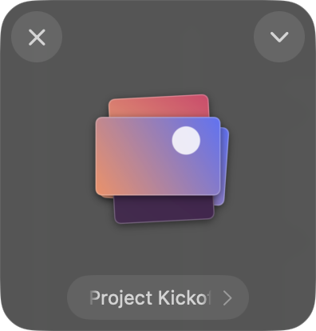
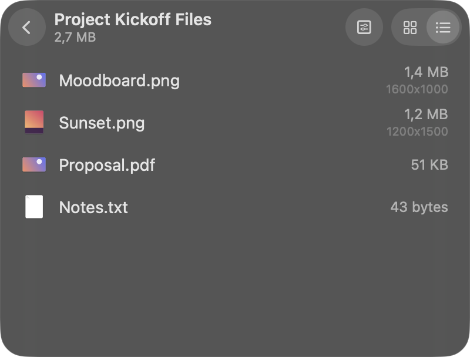
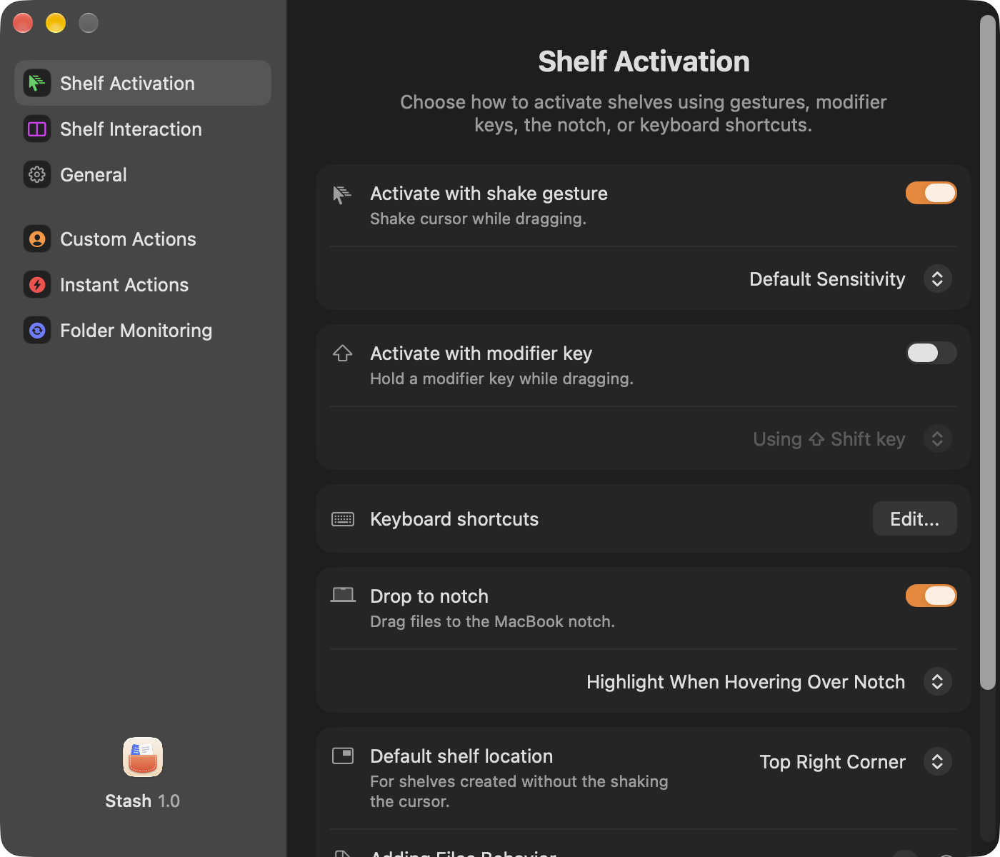
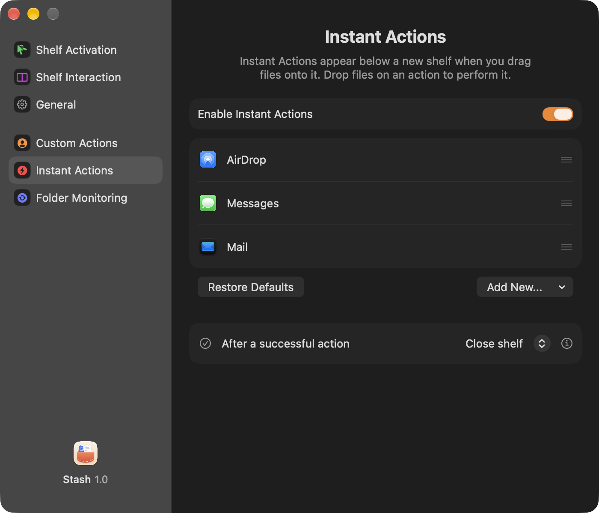

<p align="center">
  
</p>

<h1 align="center">Stash</h1>

<p align="center">
  A floating shelf for your files on macOS. Drag, stash, act.<br>
  <a href="README.tr.md">Türkçe</a>
</p>

---

Stash gives you a temporary place to put files while you work. Shake the cursor while dragging and a shelf appears; drop files on it, switch apps, and drag them out wherever they need to go. Along the way you can zip, resize, convert, rename or share them without opening another app.

<p align="center">
  
  &nbsp;&nbsp;
  
</p>

## Features

**Shelves**
- Open a shelf by shaking the cursor while dragging, holding a modifier key, dropping on the MacBook notch, a keyboard shortcut or the menu bar.
- Shelves float above other windows, can be moved, docked to a screen edge, pinned, named and color-coded.
- Recent and pinned shelves can be reopened later; shelves still open when you quit are kept as recent shelves.
- Grid and list views, Quick Look, Open With, rename in place, and drag out all or some of the files.

**Actions**
- Images: Redact Text (smart detection or manual), resize, convert format, compress, remove metadata, extract text, combine into a PDF, stitch, set as desktop picture.
- PDFs: combine, protect with a password.
- Files: zip, rename and batch rename, copy to / move to, copy paths, Get Info, move to Trash.
- Share: AirDrop, Mail, Messages and the system share menu.
- **Instant Actions**: drop files straight onto an action tile under a new shelf.
- **Custom Actions** with your own settings, plus your own UNIX or Automator scripts.

**Automation**
- Watch folders with rules (name, extension, kind, size) and show new files in a shelf.
- Screenshot shelf: new screenshots appear in a shelf.
- Shortcuts actions, a Services menu item, and `stash://` links for Raycast, Alfred or the terminal:
  ```sh
  open "stash://add?path=/path/to/file"
  open "stash://new"
  open "stash://clipboard"
  ```

**Everything else**
- English and Turkish, following the system language or chosen in Settings.
- No accounts, no cloud, no network access: your files stay on your Mac.

<p align="center">
  
  &nbsp;
  
</p>

## Requirements

- macOS 15 or later (Apple Silicon or Intel)

## Building from source

You need Xcode 26 or later (Swift 6.2) and [XcodeGen](https://github.com/yonaskolb/XcodeGen):

```sh
brew install xcodegen
git clone https://github.com/tastanmert/Stash.git
cd Stash
./scripts/build-app.sh            # builds and installs to /Applications
./scripts/build-app.sh ~/Desktop  # or to another folder
```

The script generates the Xcode project from `project.yml`, builds a universal app, draws the icon, and signs it with your Apple Development certificate if you have one (ad-hoc otherwise). Xcode is used rather than plain SwiftPM so the Shortcuts actions get their App Intents metadata.

Run the tests with:

```sh
swift test
```

## Project layout

| Path | What's there |
| --- | --- |
| `Sources/StashCore` | File operations, shake detection, folder rules, shelf records: logic without UI, covered by tests |
| `Sources/Stash` | The app: shelves, menus, actions, settings, automation (AppKit windows with SwiftUI content) |
| `Tests/StashCoreTests` | Swift Testing tests for `StashCore` |
| `Localization` | English and Turkish strings; `scripts/sync-strings.py` checks that both have every key |
| `scripts` | Build script and the icon drawing |

## Contributing

Issues and pull requests are welcome. Please keep changes focused, run `swift test`, and run `python3 scripts/sync-strings.py` if you add or change user-facing text (every string needs an English and a Turkish entry).

## License

Copyright © 2026 Mert Taştan.

Stash is free software, released under the [GNU General Public License v3.0](LICENSE). You may use, study, change and share it; if you distribute a modified version, it must also be under the GPL with its source code available.
